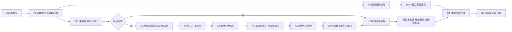

# 实际架构与接口

最终配置serial_cv1_t3没有启用跨帧检测/分类流水线。摄像头、预览、HTTP与单一推理线程并行；该推理线程内先检测，再分类，FPGA由同一所有者顺序调用。CPU detector仍未迁入PL。

## 数据格式

- 摄像头：640×480 BGR uint8；模型观察同一校正后整帧，不按检测框裁剪。
- 检测：保持原mp_palmdet.py的192×192等比缩放/黑边、RGB/255、NHWC、锚点、sigmoid及NMS；检测阈值0.6。
- 分类：RGB，最长边224，居中padding=144，按model_meta.json原mean/std归一化，NCHW FP32。
- PL输入/输出：1×40×28×28 FP32；features.5/6各含PW、DW、SE及残差，24个ONNX节点，总19,772,160 MAC，约占分类网络Conv MAC的9.24%，不是整个检测+分类计算占比。
- 8输出通道×16输入通道点卷积并行，2通道深度卷积并行；中间特征保留片内，两个参数bank分别保存两个块，不是输入ping-pong双缓冲。
- 每个bank参数20,712个FP32（82,848字节），初始化各LOAD一次；RUN输入125,456字节（含16字节包头），输出125,440字节。具体包头/opcode/端序见blocks16_driver/packet.py，不另造协议。

## PS/PL连接

Zynq UltraScale+ PS M_AXI_HPM0_FPD经控制互连访问DMA及HLS控制；DMA的内存读写主口经存储互连连接PS S_AXI_HP0_FPD。AXIS为32位，DDR内存侧DMA为64位、地址64位；DMA不使用SG。DMA AXI-Lite基址0xA0000000，HLS控制基址0xA0010000；均由同一HWH解析并核对。

DMA先准备接收，再启动IP与发送，驱动完成超时/状态检查后复制到独立输出数组。输入输出分配后复用，权重片内驻留。本版未实现跨帧DMA双缓冲，不把参数bank称作视频双buffer。复位ext_reset_in与aux_reset_in均由PS pl_resetn0驱动，ACTIVE_LOW，不能把aux固定0。

## 板卡到笔记本

- /api/status（兼容/health）：协议1、session_id、backend、metrics、observation。
- 每个observation含源帧seq、年龄age_seconds、detected、label、score、detector_ms、classifier_ms、fpga_call_ms、fpga_completed_frames。
- /api/preview为显示专用，不能送入GestureGate重复触发动作。
- 笔记本只接受新seq；跨主机会话/网络错误/过期会锁定，不当成无手。恢复后需连续真实无手解锁。两端不直接比较monotonic时钟，按板端年龄加HTTP耗时保守判断。
- 原GestureGate默认置信度0.60、至少2个新结果且保持>=0.35秒、无手释放>=0.35秒、最大结果年龄1.5秒。实际动作确认还叠加帧间隔与网络，因此302.5ms不能等同点餐动作总响应时延。

菜单阶段：张手下一项、点赞加一、握拳核对、V退出确认；核对阶段：张手切换行、握拳减一、V返回、点赞确认保存模拟订单。退出确认阶段V取消、点赞丢弃购物车。没有实现原构想中的手指定位、空中鼠标、真实支付或LED/舵机演示，不写成已有功能。
